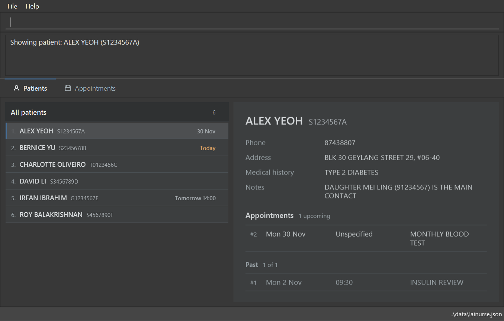
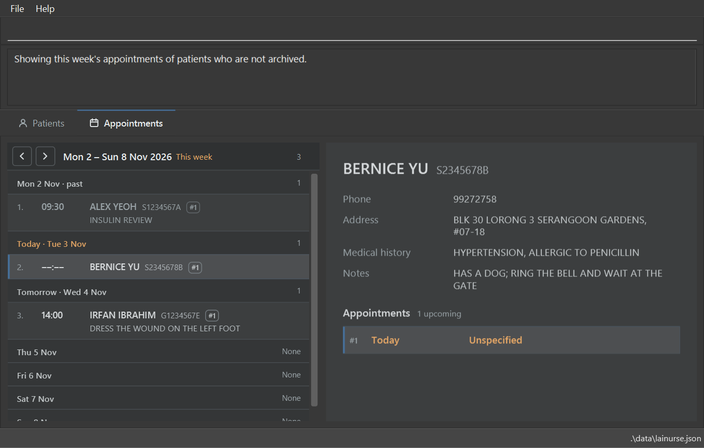
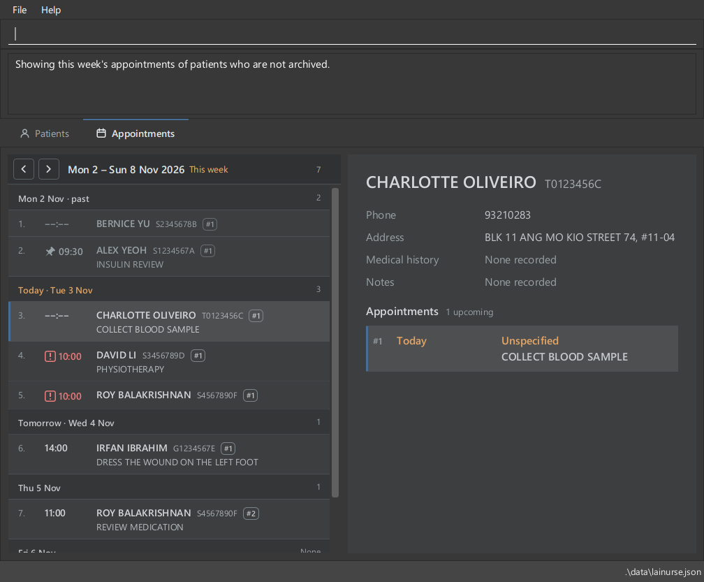

LaiNurse is a **desktop application that gives home nurses fast access to patient and appointment details for home visits, optimized for use through a Command Line Interface (CLI)** while retaining the benefits of a Graphical User Interface (GUI). If you type quickly, LaiNurse can help you look up and update patient details faster than traditional GUI applications.

* Table of Contents
{:toc}

--------------------------------------------------------------------------------------------------------------------

## Quick start

1. Ensure that Java `25` or later is installed on your computer. 
   **Mac users:** Ensure you have the precise JDK version prescribed [here](https://se-education.org/guides/tutorials/javaInstallationMac.html).

1. Download the latest `.jar` file from [here](https://github.com/AY2627S1-CS2103T-F08-2/tp/releases).

1. Copy the file to the folder you want to use as the _home folder_ for LaiNurse.

1. Open a terminal, `cd` to the folder containing the JAR file, and run `java -jar lainurse.jar`. 
   LaiNurse keeps its data in the folder you launch it from, so always launch it from this folder, rather than by double-clicking the JAR file. 
   Use a folder that you can write to, as LaiNurse cannot save its data in a write-protected folder. 
   **Mac users:** other windows, such as the Help window, may not behave as expected while LaiNurse is in fullscreen. 
   A GUI similar to the one below should appear in a few seconds. Note how the app contains some sample data: the sample appointments fall on the Monday, Tuesday and Wednesday of the week you first launch the app in, and Alex Yeoh has another one four weeks later. 
   

   

1. Type a command in the command box and press <kbd>Enter</kbd> to execute it. For example, type `help` to view the summary of all commands in the result display, type `help add` to see help specific to adding patients, or press <kbd>F1</kbd> / select **Help** > **Help** / `help window` to open the Help window with the full user guide.  

    Some example commands you can try:

   * `view` : Lists all patients.

   * `add --id T0123456B --name John Doe --phone 98765432 --address John street, block 123, #01-01` : Adds a patient named `John Doe` with the ID `T0123456B`.

   * `view S1234567A` : Shows the details of the patient with the ID `S1234567A` (Alex Yeoh, in the sample data).

   * `viewappt` : Switches to the **Appointments** view, and shows the weekly view of this week, with the next appointment from now selected.

   * `delete S1234567A` : Deletes the patient with the ID `S1234567A` (Alex Yeoh, in the sample data), after you type `confirm`.

   * `exit` : Exits the app.

1. Refer to the [Features](#features) section below for details of each command.

--------------------------------------------------------------------------------------------------------------------

## Features

**:information_source: Notes about the command format:** 

* Words in `UPPER_CASE` are the parameters to be supplied by the user. 
  For example, in `add --name NAME`, replace `NAME` with a value such as `John Doe`.

* Command words and option words are syntax and must be typed in lowercase: `view` runs the view command while `VIEW` is rejected as an unknown command, and `--details` is accepted while `--DETAILS` is not. 
  The target of `help` is a command word too, so `help view` works but `help VIEW` does not. This does not restrict the data you type: IDs and search matching are case-insensitive. 
  Tab turns command words and options into lowercase as it finishes them. See [Using the keyboard](#using-the-keyboard).

* Items in square brackets are optional. 
  For example, `--name NAME [--medical-history MEDICAL_HISTORY]` can be used as `--name John Doe --medical-history Asthma` or as `--name John Doe`. 
  An option whose value is in its own square brackets, such as `[--notes [NOTES]]` in `edit`, can also be given with no value.

* Options (words starting with `--`) can be in any order. A parameter that must come first, such as `ID` in `edit`, must stay first. 
  For example, if the command specifies `--name NAME --phone PHONE`, `--phone PHONE --name NAME` is also acceptable.

* Extraneous parameters for commands that take no parameters, such as `exit`, are ignored. 
  For example, `exit 123` is interpreted as `exit`.

* Keys such as Tab, Esc, and Up and Down save typing. See [Using the keyboard](#using-the-keyboard).

* An appointment date is written `yyyy-MM-dd`, such as `2026-10-05`, and a time, when you give one, `HH:mm`, such as `09:00`. The year has exactly four digits and no sign, and the month, day, hour and minute each have two digits. Dates such as `+12345-01-01` and `-2026-10-05` are rejected, and so are `2026-1-5` and a time such as `9:00`. This applies to `addappt`, the new date supplied to `editappt`, `viewappt`, and to appointments in the data file.

* If you are using a PDF version of this document, be careful when copying and pasting commands that span multiple lines as space characters surrounding line-breaks may be omitted when copied over to the application.

* A pasted horizontal space, such as the non-breaking space that formatted text inserts, counts as a space.

### The patient and appointment views

LaiNurse shows one view at a time. The tabs under the result display switch between them:

* **Patients**: the list of patients, sorted by name, each with their next appointment, and beside it the details of one patient.
  * The list is sorted by patient name. Case does not matter, and the ID breaks ties between patients with the same name, so two patients with the same name keep one fixed order. Renaming a patient with [`edit`](#editing-a-patient-edit) moves their row. After [`find`](#locating-patients-by-substrings-find), the patients that match more fields come first, and patients that match the same number of fields are in name order. Archived patients, when the list shows them, come after all the others either way.
  * A header above the list says whether it shows `All patients` or `Filtered patients`, such as after `find`, and how many: `12`, or `3 of 12` when filtered. It says `Filtered patients` whenever a filter is set, even one that every patient matches, such as `12 of 12`, so that you can tell that Esc will remove it. An empty list says why: `No patients yet.`, `No patients match the filter.`, `No archived patients.` or `Every patient is archived. To see them: view --all`.
  * The list hides [archived](#archiving-a-patient-archive) patients, and the header counts only the others, such as `12`. `view --all` shows archived patients too, at the bottom of the list and greyed out, and the header counts them in brackets: `12 (2)`. `view --archived` shows only them, under `Archived patients`, with `(2)`. When the list is filtered, each count shows how many of each kind it shows, such as `3 of 12 (1 of 2)`. This choice is the list's **scope**. It stays until you choose another, and goes back to the default, which hides archived patients, when LaiNurse restarts.
  * The next appointment of a patient is their first **undone** appointment that has not passed.
  * The details list every upcoming appointment of the patient, in time order, and all their past appointments, latest first and dimmed.
* **Appointments**: the appointments, day by day, and beside them the details of the selected appointment's patient, with that appointment highlighted. Each day has a heading with its number of appointments, and the appointments are numbered from 1 down the page. Each row also shows `#N` in a small box after the patient ID:
  this is the appointment's number within that patient, used by `editappt`, `deleteappt`, `markappt` and `unmarkappt`. A patient's
  appointments are numbered from 1 in date order. The details panel shows the same number, dimmed, before each date.
  * An appointment with no time shows `‒‒:‒‒` in the list, and `Unspecified` in the details, in the color of its row. It comes first in its day, except today: there it comes after the appointments that have passed, right above the next one.
  * The appointments that have passed are greyed out.
  * A done appointment shows a pin before its time in the list and patient details, and an undone one shows nothing.
    You mark and unmark appointments yourself with
    `markappt` and `unmarkappt`. Done visits remain listed, and past/upcoming grouping and counts still depend on
    dates and times. A visit can be done before its scheduled time or remain undone after it has passed.
  * The view shows the appointments of patients who are not archived. After `viewappt --all`, it shows archived patients' appointments too, and after `viewappt --archived`, only theirs. The count in the header then has the same form as the patient list's: `49 (2)` after `viewappt --all`, and `(2)` after `viewappt --archived`.
  * The view has two kinds of page. The **weekly view** shows one week, from Monday to Sunday, with a heading for every day. Its header shows the dates, and `This week`, `Last week` or `Next week` when it is one of those. A plain [`viewappt`](#viewing-appointments-viewappt) shows the weekly view of this week. After `viewappt` with a date, a range or `--id`, the view shows only the appointments that it found, on one page, with a heading for each day that has one. Its header shows the dates.

In both views, the list and the details share the width of the window, and grow and shrink together as you resize it.

An appointment has passed once its time today has gone by, or once its day is over if it has no time. So one at 10:00 has passed from 10:01. LaiNurse keeps up with the clock while it is left open: within a few seconds of an appointment passing, it is greyed out and moves under **Past**, and after midnight, the new day is marked as today. Orange marks what is today, such as today's heading and today's appointments. Blue marks what is selected, and what has the keyboard focus. Red marks clashes: two or more appointments at
exactly the same date and time, including visits to the same patient, when both are undone. Done visits do not
cause clash warnings or red highlighting. Only visits with a time can clash: two date-only visits on the same day do
not, and neither do a date-only visit and a timed one. A clashing appointment has a red boxed `!` before its time, and its time, and its date in
the details, are red, even when it has passed or is selected. This includes a clash with a patient hidden by a filter.
In the patient list, a patient's next appointment is red if it clashes, also when it is today. An archived patient's appointments never clash.
These are the rules with the default settings. [`set`](#changing-settings-set) decides whether done, past and archived patients' appointments can clash, and whether a done appointment counts as past.

Commands switch the view. `viewappt`, `editappt`, `addappt`, `markappt` and `unmarkappt` show **Appointments**, and `find`, `view`, `add`, `edit`, `archive` and `unarchive` show **Patients**. Other commands, such as `delete`, `deleteappt`, `clear`, `clearappt`, `set` and `help`, keep the view that is shown. Commands also choose what is selected:

* `add`, `edit` and `view ID` select the patient that they add, edit or show. If the patient list's scope hides that patient, because they are archived, or because the list shows only archived patients, the list shows all patients. `view` without an ID and `find` select the first patient in the list.
* `archive` and `unarchive` select the patient if the list still shows them. Otherwise, they select nothing, and the list keeps its scope: archiving a patient hides them.
* `viewappt` selects the next appointment from now: the first appointment on the page that has not passed, or the first on the page if all have passed. This automatic selection remains date-based and can select a done appointment.
* `addappt`, `editappt`, `markappt` and `unmarkappt` select the appointment that they change: on the page shown, if that page has it, or else in the weekly view of its week. If the patient is archived and the view hides their appointments, it shows archived patients' appointments too.
* `delete`, `deleteappt`, `clear` and `clearappt` select nothing, and the details beside the list show their starting message.
* `help`, `set`, and a command that fails, change nothing.

You can also click a tab, or move to the tabs with the keyboard and press Left or Right. Switching views this way runs no command, so each view still shows what it showed before.

In the weekly view, click the arrow buttons above the list to see another week, or press Left or Right with the focus in the list. The arrows show only in the weekly view, and only if there is a week to go to, so the first week of `0000` has no left arrow, and the last week of `9999` has no right arrow. Esc in the list goes back from a `viewappt` page to the weekly view of the selected appointment's week, and keeps that appointment selected. It also removes `--all` or `--archived`, unless the selected appointment is an archived patient's. In the weekly view, Esc hides archived patients' appointments again, if they are shown, and otherwise does nothing; a plain `viewappt` goes back to this week.

### Using the keyboard

You can use LaiNurse without the mouse. The keyboard focus is in the command box or in the view that is shown. In the view, it is on the view tabs or in the list below them, and Tab, Up and Down move between the two. Esc moves from the command box to the view, and typing or Enter moves back. The part with the focus has a blue border, and the command box is dimmed while the focus is elsewhere. The details beside the list do not take the focus. To scroll them, press Shift+Up and Shift+Down in the view, or use the mouse.

**In the command box:**

Key | What it does
--------|------------------
Enter | Runs the command.
Tab | Finishes the word you are typing: a command word, an option such as `--phone`, or a patient ID. While you type, the status bar at the bottom of the window shows what Tab can fill in. See below. With nothing to finish, such as in an empty command box, it does nothing.
Up and Down | Go back and forth through the commands you entered since LaiNurse started, including ones that failed. Down after the newest command gives back what you were typing.
Esc | Moves to the list of the view that is shown, or to the tabs if the patient list is empty. What you typed stays in the command box.
Shift+Up and Shift+Down | Scroll the result display, for a message too long to show at once.

**On the view tabs:**

Key | What it does
--------|------------------
Left and Right | Show the **Patients** or the **Appointments** view.
Down and Tab | Move to the list below the tabs.
Up | Does nothing, so the focus stays on the tabs.
Other keys | Work as they do in a list, below.

**In a list:**

Key | What it does
--------|------------------
Up and Down | In the patient list, select the previous or next patient and show their details. In the appointment list, select the previous or next appointment and show its patient's details. Up at the first patient, or at the first appointment of the page, moves to the view tabs.
Ctrl+Up and Ctrl+Down (Cmd+Up and Cmd+Down on macOS) | Select the first or last patient in the patient list, or the first or last appointment of the page in the appointment list.
Page Up and Page Down | Move about one screen up or down the list, and show the details of what they select. In the appointment list, they select the nearest appointment, never a day heading.
Home and End | Select the first or last patient in the patient list, or the first or last appointment of the page in the appointment list.
Left and Right | In the weekly appointment view, show the previous or next week, and select its first appointment. The weeks stop at the years `0000` and `9999`, so the first and last weeks have only the days in those years, and Left and Right do nothing past them. On a `viewappt` page, they do nothing.
Shift+Up and Shift+Down | Scroll the details beside the list.
Tab | Moves to the view tabs.
Any letter, digit or space | Goes back to the command box and types it there, after what you typed before.
Enter | Goes back to the command box, keeping what you typed.
Esc | In the patient view, removes the filter of `find`, and keeps the scope, such as `--all`. With no filter, it goes back to the default scope, as `view` does. It runs no command, so it keeps the patient already selected and the status message. So after `view --all` and a `find`, the first Esc shows all patients, archived ones too, and the second hides the archived ones again. In the appointment view, goes back from a `viewappt` page to the weekly view of the selected appointment's week, or of this week if none is selected, and keeps the selection. It also removes `--all` or `--archived`, unless the selected appointment is an archived patient's. In the weekly view, it hides archived patients' appointments again, if they are shown, and otherwise does nothing.

* Shift+Tab does nothing, in the command box or in the view.
* The appointment list takes the focus even in a week with no appointments, so that Left and Right still work. Up there moves to the view tabs.
* When the focus moves to the patient list, the patient whose details are shown stays selected. If no patient in the list is selected, LaiNurse selects the first one and shows their details. So the selected patient is always the one shown.
* When the focus moves to the appointment list and no appointment is selected, LaiNurse selects the first appointment that has not passed, on a page that includes today, or the first appointment of another page, and shows its patient's details.
* For example, after `find --address serangoon`, press Esc to move to the results, then Down to look through them one by one. Press Esc again to see all patients, and start typing to enter the next command.
* While you type, the left end of the status bar shows a **Tab** key followed by each word that Tab can fill in, such as **Tab** `delete · deleteappt` after `dele`. With more than five, it shows the first five and how many others there are, such as `+19 more`. Press Tab to fill in the first one, and Tab again to go through the others. The status bar keeps showing them while you do. When Tab has nothing to fill in, or the focus is not in the command box, the status bar shows only where your data is saved.
* Tab finishes these words:
  * **Command words.** For example, `dele` gives `delete`, then `deleteappt`. `view` gives `viewappt`, so type a space after `view` to finish a patient ID instead. When there is only one match, the next Tab goes on to the patient ID if the command takes one, so `addap` gives `addappt`, and the next Tab `addappt S1234567A`.
  * **Options.** Type `-` or the start of an option. For example, `edit S1234567A --ph` gives `edit S1234567A --phone`. Tab offers only the options of that command, and skips the ones you have already typed, and the ones that cannot be given with them: `--all` and `--archived` exclude each other, and in `view` and `viewappt`, a patient ID excludes both.
  * **Patient IDs** after `view`, `delete`, `archive`, `unarchive`, `edit`, `addappt`, `editappt`, `deleteappt`, `markappt`, `unmarkappt` or `clearappt`, and after `--id` in `viewappt`. Type the first few characters of the ID, or none. Patients in the displayed list come first, and archived patients last. For example, `view s12` gives `view S1234567A`. 
    With `edit`, `addappt`, `editappt`, `deleteappt`, `markappt` and `unmarkappt`, Tab also works after you have typed the remaining arguments, and keeps them. For example, `edit s12 --phone 91234567` becomes `edit S1234567A --phone 91234567`, and `markappt s12 2` becomes `markappt S1234567A 2`.
  * **Help topics** after `help`. For example, `help ad` gives `help add`, then `help addappt`. `help w` gives `help window`.
  * **Settings** after `set`. For example, `set mark` gives `set mark-noclash`, then `set mark-past`, and `set past-clash ` gives `set past-clash on`, then `set past-clash off`.
* Tab matches what you type in any case, but fills in command words, options, help topics and settings in lowercase, as LaiNurse expects them. For example, `DELE` gives `delete`, then `deleteappt`, and `--PH` gives `--phone`. A whole word in the wrong case, such as `VIEW`, gives the lowercase word first, then the longer ones: `view`, then `viewappt`. The command word and options before the word you complete must already be in lowercase, so `EDIT S1234567A --PH` and `HELP W` give nothing to fill in.
* The command box supports the usual editing keys. For example, Shift+Left and Shift+Right select text, and Ctrl+C, Ctrl+X, Ctrl+V and Ctrl+A copy, cut, paste and select all (Cmd instead of Ctrl on macOS).

### Viewing help: `help`

Accesses in-app guidance through the command line or opens the full built-in User Guide window.

LaiNurse offers three ways to get help:

1. **Full User Guide Window** (<kbd>F1</kbd> / select **Help** > **Help** / `help window`): Opens a dedicated help
   window containing the complete, bundled User Guide for convenient browsing alongside your work, as well as a button to copy the link to the online guide.
2. **Command Overview** (`help`): Prints a concise list and summary of all available commands directly in the application's result display box.
3. **Targeted Command Help** (`help COMMAND`): Displays detailed usage rules, parameter formats, and examples for a specific command directly in the result display box.

Format: `help [COMMAND]`

* Typing `help` without arguments outputs a summary of all commands in the result display, including help itself.
* Adding a command name (e.g., `help add`, `help edit`, `help help`) displays the syntax and practical examples for that command.
* Typing `help window` opens the pop-up Help Window containing the complete User Guide.
* Typing an unknown command name (e.g., `help 3`), a wrong-case target (e.g., `help VIEW`), or the unsupported `help --COMMAND` flag form results in an invalid command format error that lists the valid targets.

Examples:
* `help add` shows the exact parameters and examples for adding a patient.
* `help window` opens the full User Guide window.

### Adding a patient: `add`

Adds a patient to LaiNurse.

Format: `add --id ID --name NAME --phone PHONE --address ADDRESS [--medical-history MEDICAL_HISTORY] [--notes NOTES]`

* `--id`, `--name`, `--phone`, and `--address` are required. Each must have a non-blank value.
* Medical history and notes are independently optional. If an option is supplied, its value must not be blank.
* Notes record other personal information not covered by the other fields, such as the patient's hobbies, pet peeves and daily routines. Use `--medical-history` for health information.
* Parameters may appear in any order. Each option may appear only once. Separate options and values using spaces or tabs; values may contain spaces.
* IDs contain 1 to 10 letters or digits. IDs are case-insensitive, and a patient with an existing ID cannot be added again. LaiNurse then names the patient who has that ID, such as `ALEX YEOH (S1234567A) already exists in LaiNurse.` If that patient is archived, it says so, and how to unarchive them: `ALEX YEOH (S1234567A) already exists in LaiNurse, and is archived. To unarchive them: 'unarchive S1234567A'`
* Names, addresses, medical history and notes accept any non-blank text. IDs and these text fields are stored in uppercase, with repeated whitespace collapsed.
* Unlike in `find`, quotes are not removed: they are stored as part of the value. For example, `--notes "Likes tea"` stores `"LIKES TEA"`, with the quotes, so leave them out.
* Patients with different IDs may share a name. The patient is added and saved as usual, and a warning below the success
  message names every other patient with the same complete name, including archived patients and those hidden by a
  filter. Matching ignores case and repeated whitespace. For example: `Warning: this name is also used by ALEX YEOH
  (S1234567A). Check the patient IDs.` Archived matches have `[archived]` after their ID. No confirmation is required.
* Invisible characters that text pasted from a website can carry, such as the zero-width space, are removed from names, addresses, medical history, notes and appointment details, so a value is stored as you see it, and a value of such characters only counts as blank. For example, `Alex` and `Smith` joined by a zero-width space is stored as `ALEXSMITH`, which `find --name alexsmith` finds. The characters that some scripts and emoji need, such as in 👩‍⚕️, are kept. An ID or a date with an invisible character is rejected, and a phone number is rejected if it carries a common one, such as the zero-width space.
* Phone numbers accept any non-blank text containing at least three digits — for example, `1234 5678 (HP) 1111-3333`, `+65 9876-5432` or `9312.1534`, and are stored in uppercase.
* A new patient starts with no appointments. Set their appointments with [`addappt`](#adding-an-appointment-addappt).
* Whitespace-delimited words beginning with `--` are reserved for options, including within text fields, and there is no way to enter one in a value. For example, `--notes take --daily meds` is rejected, even in quotes, so write `take daily meds` instead. Text such as `Anne--Marie` is accepted. Unknown options, misspellings, and `--name=value` syntax are rejected with the command usage instructions.
* After a patient is added, the list shows all patients again, even if it was showing `find` results. It keeps its scope, unless it shows only archived patients: then it shows all patients, archived ones too, so that the new patient is in it. The list numbers of other patients may change. The new patient is selected in the list, and their details are shown, as `view` does.

Examples:

* `add --id T0123456B --name John Doe --phone 98765432 --address John street, block 123, #01-01`
* `add --medical-history Asthma --address Block 312, Clementi Ave 2 --phone 91234567 --name Betsy Crowe --id S2222222B`
* `add --id S4444444D --name Mary Tan --phone 91234567 --address Blk 10 Clementi Ave 2 --notes Enjoys gardening; walks every morning`
* `add --name James Ho --id S3333333C --address 123, Clementi Rd, 1234665 --phone 22224444`

### Editing a patient: `edit`

Edits the details of an existing patient.

Format: `edit ID [--name NAME] [--phone PHONE] [--address ADDRESS] [--medical-history [MEDICAL_HISTORY]] [--add-medical-history MORE_HISTORY] [--notes [NOTES]] [--add-notes MORE_NOTES]`

* Edits the patient with the given `ID`, which is the patient ID shown in their row, not their position in the list. The patient does not have to be in the list currently shown.
* `ID` must come first; the other parameters may appear in any order. Separate options and values using spaces or tabs.
* As in `add`, quotes are stored as part of the value, so leave them out.
* As in `add`, whitespace-delimited words beginning with `--` are reserved for options, and there is no way to enter one in a value. Unknown options, misspellings, and `--id` are rejected with the command usage instructions.
* The ID itself cannot be edited. To correct a wrong ID, delete the patient and add them again. Deleting a patient also deletes their appointments, so note them down first with [`viewappt --id ID`](#viewing-appointments-viewappt), and add them again with [`addappt`](#adding-an-appointment-addappt).
* At least one of the optional parameters must be provided.
* `--name`, `--phone`, `--address`, `--medical-history` and `--notes` replace the existing value, and follow the same rules as in [`add`](#adding-a-patient-add). `--medical-history` and `--notes` can also set a value for a patient who has none.
* `--medical-history` or `--notes` with no value clears that field. For example, `edit S1234567A --notes` removes the patient's notes. In `add`, a blank value is still rejected.
* `--add-medical-history` and `--add-notes` add text to the end of the field, after `; `. If the field is empty, the text becomes its value. The text to add cannot be blank.
* A field can be replaced or added to, not both: `--notes` and `--add-notes` together are rejected, and so are `--medical-history` and `--add-medical-history`. Each option may appear only once.
* Omitting all the options for a field keeps its existing value.
* The patient's appointments are not changed here. Change them with [`addappt`](#adding-an-appointment-addappt), [`editappt`](#editing-an-appointment-editappt) or [`deleteappt`](#deleting-an-appointment-deleteappt); they keep their details and order otherwise.
* After a patient is edited, the list shows all patients again. The edited patient is selected in the list, and their details are shown, as `view` does. Renaming a patient moves their row, to keep the list sorted by name.
* An archived patient can be edited, and stays archived.
* If the resulting name is shared with another patient, the edit is saved and the result shows the same warning as
  [`add`](#adding-a-patient-add), including archived patients and those hidden by a filter. This also applies when only
  another field is edited, or the name is given again unchanged. The patient being edited does not count as a match.

Examples:
*  `edit S1234567A --phone 91234567 --address Blk 30 Geylang Street 29, #06-41` changes the phone number and address of patient `S1234567A`.
*  `edit S1234567A --medical-history Type 2 diabetes, hypertension` replaces the medical history of patient `S1234567A`.
*  `edit S1234567A --notes Enjoys gardening; dislikes loud noises` replaces the notes of patient `S1234567A`.
*  `edit S1234567A --add-medical-history Asthma` changes Alex Yeoh's medical history in the sample data from `TYPE 2 DIABETES` to `TYPE 2 DIABETES; ASTHMA`.
*  `edit S1234567A --notes --add-medical-history Asthma` clears the notes of patient `S1234567A`, and adds `ASTHMA` to the end of their medical history.

### Locating patients by substrings: `find`

Finds patients whose specified fields contain any of the supplied substrings.

Format: `find [--id ID] [--name NAME] [--address ADDRESS] [--phone PHONE] [--medical-history HISTORY] [--notes NOTES] [--all] [--archived]`

* `find` searches patient details only. To search by appointment date, use [`viewappt`](#viewing-appointments-viewappt).

* Supply at least one option. Each supplied option must have a non-blank value and may appear only once.
* Parameters may appear in any order. Separate options and values using spaces or tabs; values may contain spaces.
* Values may be unquoted or enclosed in matching straight double quotes (`"Mary"`) or curly double quotes (`“Mary”`). Quotes must surround the complete value; missing or mismatched closing quotes and text after a closing quote are rejected.
* Matching ignores case and repeated whitespace. For example, `--name han` matches `Hans`, and `--address "marina   bay"` matches `Marina Bay`.
* Each value is one contiguous substring of its corresponding field, using digits only for phone numbers. For example, `--address "Marina Bay"` matches that phrase, while `--address "Bay Marina"` does not match `Marina Bay`.
* Patients matching **any** supplied option are returned (an `OR` search). For example, `--name John --address "Marina Bay"` finds patients whose name contains `John` **or** whose address contains `Marina Bay`. Each patient appears once.
* Patients matching more supplied fields appear first. For example, a patient matching both name and address appears before one matching only name or only address. Each field counts once, even if the substring occurs several times. Patients matching the same number of fields are in name order, so a single-field search shows its results in name order. With `--all`, archived patients come after all the others, even those that match fewer fields.
* Phone searches compare digits only, ignoring spaces, punctuation and every other non-digit character in both the search value and stored number. For example, `--phone 987654` and `--phone "(9876)-54"` both match `+65 9876-5432`. Partial values such as `--phone 123` or `--phone 5` are accepted. Leading zeros and country-code digits are preserved. A phone search must contain at least one digit (`0–9`); values such as `"+-()"` or `abc` are rejected, even when another search option is supplied.
* Patients without medical history do not match a `--medical-history` search, but may match another supplied option.
* `--notes` searches the patient's personal notes. Patients without notes do not match this option, but may match another supplied option.
* Whitespace-delimited words beginning with `--` are reserved for options, including within quoted values. Unknown options, misspellings, and `--name=value` syntax are rejected. Text such as `Anne--Marie` is accepted.
* The first match is selected, and their details are shown. If nothing matches, nothing is selected.
* Each search checks all patients in the list's scope, even when the list is already filtered. By default, that is the patients who are not archived. No matches produces an empty list and a count of zero. Invalid commands leave the displayed list unchanged. To see all patients again, enter `view`, or press Esc twice: once to move to the patient list, and once to show all patients with the selected patient still selected.
* `--all` searches all patients, archived ones too, and `--archived` only archived patients. Either option also sets the list's scope, so the list keeps showing archived patients after you clear the search. They take no value, and cannot be given together. At least one other option is still needed.

Examples:

* `find --name "John" --address "Marina Bay"` finds patients whose name contains `John` or whose address contains `Marina Bay`, with patients matching both fields first.
* `find --name Irfan --id 1234567` on the sample data shows Irfan Ibrahim before Alex Yeoh, because Irfan matches both fields while Alex matches only ID.
* `find --id “T04”` finds patients whose ID contains `T04`.
* `find --phone "(43)-88"` on the sample data finds Alex Yeoh, whose phone number is `87438807`.
* `find --medical-history penicillin --name tan` finds patients whose medical history contains `penicillin` or whose name contains `tan`.
* `find --notes "enjoys gardening"` finds patients whose notes contain that phrase.
* `find --name yu --archived` finds archived patients whose name contains `yu`.

### Viewing appointments: `viewappt`

Shows only the appointments on a date, or between two dates, in the appointment view. With `--id`, shows only that patient's appointments.

Format: `viewappt [DATE]` or `viewappt [--from START_DATE] [--to END_DATE]`, each with an optional `[--id ID]`, or an optional `[--all]` or `[--archived]`

* All dates must be real dates, in the appointment date format described in the notes about the command format above.
* `viewappt DATE` looks for appointments on `DATE`.
* With `--from` and `--to`, the range includes both dates. Give one of them or both, in any order, each at most once.
* Without `--from`, the range starts today. Without `--to`, the range has no end. A plain `viewappt`, with no date and no options, shows the weekly view of this week, and says `Showing this week's appointments of patients who are not archived.`; with `--all` or `--archived`, it says which appointments it shows instead. To see the appointments from today onwards, give `--from` with today's date.
* "Today" is the current date on your computer, in its time zone. If your computer is set to a different time zone from where you visit patients, "today" can be a day off near midnight.
* The `--from` date must not be later than the `--to` date. With only `--to`, the date must not be before today. To see past appointments, give `--from` too.
* `DATE` cannot be combined with `--from` or `--to`, and comes before the options.
* `--id ID` narrows the appointment page to the patient with that ID, together with the date range. It combines with `DATE` (which must come first, as above) and with `--from` and `--to` in any order, and can be the only argument: `viewappt --id ID` shows every appointment of that patient, past and upcoming, on one page.
* The ID is case-insensitive, as in [`view`](#listing-patients-and-viewing-a-patients-details-view), and must belong to a patient. If no patient has it, LaiNurse shows an error, and the appointment page stays as it was.
* LaiNurse switches to the **Appointments** view, and shows the appointments in the range on one page, in place of the weekly view. With `--id`, the header above the list starts with the patient's ID. The next appointment from now is selected, and its patient's details are shown: on a page that includes today, the first that has not passed, and otherwise the first on the page. If no appointment is in the range, the page says `No appointments in this range.`
* To go back to the weekly view, press Esc with the focus in the appointment list. The weekly view shows the week of the selected appointment, which stays selected, or this week if none is selected. See [The patient and appointment views](#the-patient-and-appointment-views).
* The patient list, on the **Patients** tab, stays as it was: `viewappt` does not change which patients it shows. Without `--id`, the status message says how many patients have an appointment in the range, such as `3 patients with appointments on 2026-10-15`, and with `--id`, how many appointments that patient has in it.
* Only dates are compared, so an appointment earlier today still counts.
* Without `--id`, `viewappt` shows the appointments of patients who are not archived. `--all` shows archived patients' appointments too, and `--archived` only theirs. They take no value, and cannot be given together, or with `--id`, which shows that patient's appointments whether they are archived or not. The header then counts them as it would among everyone's: `3`, or `(3)` for an archived patient. Like the dates, the option applies to this `viewappt` only: the next `viewappt` without it hides archived patients' appointments again.

Examples:
* `viewappt` shows this week.
* `viewappt 2026-10-15` shows the appointments on October 15, 2026.
* `viewappt --from 2026-10-01 --to 2026-10-31` shows the appointments in October 2026.
* `viewappt --to 2026-10-31` shows the appointments from today to October 31, 2026.
* `viewappt --from 2026-12-01` shows the appointments on or after December 1, 2026.
* `viewappt --id S1234567A` shows all of Alex Yeoh's appointments.
* `viewappt --id S1234567A --from 2026-10-01 --to 2026-10-31` shows the appointments Alex Yeoh has in that range.
* `viewappt --all --from 2026-10-01` shows everyone's appointments from October 1, 2026, archived patients' too.

### Adding an appointment: `addappt`

Adds an appointment to a patient's schedule.

Format: `addappt ID --date DATE_OR_DATETIME [--details DETAILS]`

* `ID` is the patient's ID, as in [`edit`](#editing-a-patient-edit), and must come first. The patient does not have to be in the list currently shown: even under a `find` filter, which stays, the patient may still be hidden when you return to the Patients view.
* `--date` gives the date, or date and time, of the new appointment, in the appointment date format described in the notes about the command format above. Past dates are accepted. Without `--date`, LaiNurse says that the date is missing.
* `--details` sets the appointment's details, such as what to do or bring. Like notes, details are stored in upper case, and cannot be blank. Quotes are stored as part of the details, so leave them out.
* `--date` and the optional `--details` can be in either order after the ID, and each may be given only once.
* The new appointment starts **Undone**.
* A patient's appointments are numbered from 1 in date order: by date, then by time, with an appointment that has no time first on its date. A new appointment at the same date and time as another comes after it. Adding, moving or deleting an appointment renumbers the patient's appointments after it, so check the number shown before you use it in a command.
* Clashes are allowed, including several undone visits to the same patient at exactly the same time. The result warns
  about each appointment that it clashes with: another patient's by their name, ID and appointment number, such as
  `BERNICE YU (S2345678B), appointment #1`, and the same patient's other visit as `this patient's appointment #1`.
  Visits are never rejected just because they clash.
* An archived patient can be given appointments. They never clash, and the result ends with a note that the patient is archived, and how to unarchive them.
* LaiNurse switches to the **Appointments** view and selects the new appointment. If the page shown has it, the page stays; otherwise, the week of the appointment is shown.

Examples:
* `addappt S1234567A --date 2026-10-12 09:30` gives Alex Yeoh an appointment on 12 October at 09:30.
* `addappt S2345678B --date 2026-10-14 --details Check blood pressure` gives Bernice Yu an appointment on 14 October with no time, and details.
* `addappt S1234567A --date 2026-12-01 10:00 --details Bring insulin pen` gives Alex Yeoh an appointment on 1 December at 10:00 with details.

### Editing an appointment: `editappt`

Moves one of a patient's appointments to another date or time, or changes its details, or both.

Format: `editappt ID NUMBER [--date NEW_DATE_OR_DATETIME] [--details [DETAILS]] [--add-details MORE_DETAILS]`

* `ID` is the patient's ID, as in [`edit`](#editing-a-patient-edit), and must come first. The patient does not have to be in the list currently shown.
* `NUMBER` is the appointment's number shown as `#N`, without the `#`: its place among the patient's appointments in
  date order. Numbers belong to a patient; they are different from the positions down the appointment page. If the patient has no such number, nothing is changed.
* `--date` moves the appointment to a new date, or date and time, in the same format as in [`addappt`](#adding-an-appointment-addappt). Giving a date alone turns it into an appointment with no time.
* `--details` sets the appointment's details, such as what to do or bring, replacing any it had. Like notes, details are stored in upper case. Quotes are stored as part of the details, so leave them out. With no value, `--details` clears the details.
* `--add-details` adds text to the end of the details, after `; `, or sets the details if the appointment has none. The text to add cannot be blank. `--details` and `--add-details` cannot be given together.
* Give at least one of `--date`, `--details` and `--add-details`. The options may appear in any order after the ID and number, each at most once.
* Moving an appointment keeps its details, unless `--details` is also given to replace or clear them, or `--add-details` to add to them.
* Changing only an appointment's details keeps its number. Moving it gives it the number of its new place in date
  order, after any appointment already at that date and time, and renumbers the others. Either way, it keeps its
  Done/Undone status. Use `unmarkappt` to reopen a done visit, even after rescheduling it. A move onto another visit is allowed and produces a clash
  warning if both visits are undone. An edit that changes only details also warns if the visit clashes.
* For an archived patient, the result ends with a note that the patient is archived, as in `addappt`.
* LaiNurse switches to the **Appointments** view and selects the edited appointment. If the page shown has it, the page stays; otherwise, the week of the appointment is shown.

Examples:
* `editappt S1234567A 1 --date 2026-10-06 10:00` moves Alex Yeoh's insulin review (#1) from its Monday 09:30 slot to the next day, 10:00, keeping its number and details. The sample appointments fall in the week you first launched the app in; the dates here are for the week of Monday 5 October 2026.
* `editappt S2345678B 1 --details Check blood pressure` sets the details of Bernice Yu's appointment (#1) on the Tuesday of the sample week.
* `editappt S1234567A 2 --date 2026-11-03 08:00 --details Fasting blood test` moves Alex Yeoh's monthly blood test (#2), on the Monday four weeks later, to the following day, 08:00, and replaces its details.
* `editappt S1234567A 1 --add-details Bring glucometer` changes the details of Alex Yeoh's insulin review (#1) to `INSULIN REVIEW; BRING GLUCOMETER`.
* `editappt S1234567A 2 --details` clears the details of Alex Yeoh's monthly blood test (#2).

### Deleting an appointment: `deleteappt`

Deletes one appointment of a patient, identified by its number.

Format: `deleteappt ID NUMBER`

* `ID` is the patient's ID, as in [`edit`](#editing-a-patient-edit), and must come first. The patient does not have to be in the list currently shown.
* `NUMBER` is the positive appointment number shown as `#N`, without the `#`. Only that visit is removed, even when
  others share its date and time. The patient's appointments after it move up one number.
* If the patient has no appointment with that number, nothing is changed, and the error names the missing number.
* LaiNurse keeps the view that is shown, as `delete` does. In the **Appointments** view, it keeps the page that is shown, and the deleted appointment disappears from it. No other appointment, page or filter is changed.

Examples:
* `deleteappt S1234567A 1` deletes Alex Yeoh's insulin review (#1), on the Monday of the sample week at 09:30, with its details.
* `deleteappt S1234567A 2` deletes Alex Yeoh's monthly blood test (#2), four weeks later, which has no time.

### Deleting many appointments: `clearappt`

Deletes every appointment, all appointments of one patient, or every appointment in a range of dates. The patients stay. You confirm the deletion first: LaiNurse says what it would delete, and you type `confirm` to go ahead. Anything else cancels. See the caution under [`clear`](#deleting-many-patients-clear).

Format: `clearappt [ID] [--from DATE_OR_DATETIME] [--to DATE_OR_DATETIME]`

* With no parameters, `clearappt` deletes every appointment of every patient.
* With an `ID`, it deletes only that patient's appointments. The ID comes first, before any option. The patient does not have to be in the list shown.
* `--from` and `--to` limit the deletion to the appointments from one date, or date and time, to another, both included. Either can be left out, for no limit on that side. A date without a time is the start of that day after `--from`, and the end of that day after `--to`. An appointment with no time counts as at the start of its day: `--from 2026-10-05 10:00` keeps a date-only appointment on `2026-10-05`.
* `--from` must not be after `--to`.
* It deletes the appointments of every patient, also patients hidden by a filter, and archived patients.
* The patient's remaining appointments are numbered again from 1, in date order.
* LaiNurse keeps the view that is shown, and selects nothing.

Examples:
* `clearappt S1234567A` deletes both of Alex Yeoh's appointments, after you confirm it.
* `clearappt --to 2026-10-04` deletes every appointment up to the end of 4 October 2026, such as the visits of last month that you no longer need.
* `clearappt G1234567E --from 2026-10-01 --to 2026-10-31 12:00` deletes Irfan Ibrahim's appointments from 1 October 2026 to noon on 31 October 2026.

### Marking an appointment as done: `markappt`

Marks one appointment as **Done**.

Format: `markappt ID NUMBER`

* `ID` is the patient's ID, ignoring case, and must come first. The patient need not be in the displayed list;
  the existing patient filter stays in place.
* `NUMBER` is the appointment's number shown as `#N`, without the `#`. It belongs to that
  patient and differs from the appointment's position down the page. Date/time selectors and extra arguments
  are not accepted.
* Marking is allowed for past, current and future appointments. It changes only completion: the appointment
  keeps its number, date, time and details, and every other appointment stays as it was.
* Done appointments remain visible, with a pin before their time, but are skipped in the patient's next-appointment
  summary and do not cause clashes. Marking one of two clashing visits removes the clash from both: the other visit's
  time is no longer red, and loses its `!`. Date-based ordering, counts and automatic list selection stay the same.
* A missing patient, missing appointment or already done appointment produces an error and changes nothing.
* LaiNurse shows **Appointments** and selects the marked visit. If the current page contains it, that page
  stays; otherwise, the appointment's week is shown. The status is saved automatically.

Example: `markappt S1234567A 2` marks appointment #2 of Alex Yeoh as done.

### Unmarking an appointment as undone: `unmarkappt`

Sets a done appointment back to **Undone**, for example to correct a mistaken completion.

Format: `unmarkappt ID NUMBER`

* Uses the same patient ID, appointment number, date permissions and navigation as `markappt`.
* Changes only completion, keeping the appointment and its other values intact. The pin goes away
  immediately, and the visit can again be the patient's next appointment if it has not passed.
* Restores applicable clash highlighting and appends a warning naming any other undone visits at the same
  date and optional time, including visits of hidden patients.
* A missing patient, missing appointment or already undone appointment produces an error and changes nothing.

Example: `unmarkappt S1234567A 2` sets Alex Yeoh's appointment #2 back to undone.

### Listing patients and viewing a patient's details: `view`

Shows a list of all patients, sorted by name, or all the details of a patient in the panel beside the patient list.

Format: `view [--all]`, `view [--archived]` or `view ID`

**Without an ID**, `view` lists all patients:

* `view` lists the patients who are not archived, `view --all` all patients, with archived ones at the bottom and greyed out, and `view --archived` only archived patients. The list keeps this scope until you choose another. See [The patient and appointment views](#the-patient-and-appointment-views).
* It removes the filter of `find`. The first patient is selected, and their details are shown.
* Each row shows the patient's list number, name and ID, and their next appointment if they have one. The next appointment is the earliest one today or later, so past appointments are not shown. A name too long for the row ends in `…`, and `view ID` shows it in full.
* Next appointments are shown relative to today: `Today 09:30`, `Tomorrow`, a weekday such as `Tue 14:00` within the next 6 days, and a date such as `30 Nov` or `5 Jan 2027` after that. Today's appointments are highlighted.
* `--all` and `--archived` take no value, and cannot be given together.

**With an ID**, `view` shows that patient's details:

* Shows the patient with the specified `ID`. IDs are case-insensitive, so `s1234567a` and `S1234567A` refer to the same patient.
* The patient does not need to be in the displayed list, because `view` searches all patients, archived ones too. The list then shows all patients again, and the patient's row is selected. If the patient is archived and the list hides archived patients, it shows them too, as `view --all` does.
* `view ID` takes no `--all` or `--archived`, since it shows the patient whether they are archived or not.
* If no patient has that ID, LaiNurse shows an error, and the panel keeps showing what it showed before.
* LaiNurse switches to the **Patients** view.
* The panel shows the patient's name, ID, phone number, address, medical history, notes and appointments. Notes appear below medical history, with `None recorded` when no notes have been supplied. Under **Appointments**, it lists every appointment that has not passed, in time order. Under **Past**, it lists those that have passed, latest first and dimmed, including any earlier today. An appointment today or tomorrow shows `Today` or `Tomorrow`, and one with no time shows `Unspecified`. A patient with no appointment left shows `None upcoming`. If the details do not fit, press Shift+Down with the focus in the view, or scroll down the panel.
* The panel stays up to date. After you edit the patient, it shows the new details. After you delete the patient, or delete them with `clear`, it goes back to its starting message.
* You can also click a patient in the list to see their details, or press Esc and move to them with Up and Down. See [Using the keyboard](#using-the-keyboard).

Examples:
* `view` lists the patients who are not archived.
* `view --archived` lists the archived patients.
* `view S1234567A` shows the details of the patient with the ID `S1234567A`.

### Archiving a patient: `archive`

Archives a patient, such as one who has been discharged, so that they are out of the way but not lost.

Format: `archive ID`

* Archives the patient with the specified `ID`. IDs are case-insensitive, and the patient does not need to be in the displayed list.
* An archived patient keeps every detail and appointment. Every command that takes their ID still works on them, such as `view`, `edit` and `addappt`.
* The patient list and the appointment view hide archived patients, until you give `--all` or `--archived` to [`view`](#listing-patients-and-viewing-a-patients-details-view), [`find`](#locating-patients-by-substrings-find) or [`viewappt`](#viewing-appointments-viewappt).
* An archived patient's appointments never clash, with each other or with anyone else's.
* Archiving a patient who is already archived shows an error and changes nothing.
* LaiNurse switches to the **Patients** view. If the list still shows the patient, as after `view --all`, they stay selected, now greyed out. Otherwise, nothing is selected.

Examples:
* `archive S2345678B` archives Bernice Yu.

### Unarchiving a patient: `unarchive`

Unarchives a patient, so that they show again with the other patients.

Format: `unarchive ID`

* Unarchives the patient with the specified `ID`, which works as in [`archive`](#archiving-a-patient-archive). Their appointments can clash again.
* Unarchiving a patient who is not archived shows an error and changes nothing.
* LaiNurse switches to the **Patients** view, and selects the patient if the list shows them. After `view --archived`, the list no longer does, so nothing is selected.

Examples:
* `unarchive S2345678B` unarchives Bernice Yu.

### Deleting a patient: `delete`

Deletes the specified patient and all their appointments from LaiNurse. You confirm the deletion first.

Format: `delete ID`

* Deletes the patient with the specified `ID`. IDs are case-insensitive, so `s1234567a` and `S1234567A` refer to the same patient.
* The patient does not need to be in the displayed list, because `delete` searches all patients.
* If no patient has that ID, LaiNurse shows an error and deletes nothing.
* LaiNurse first says what it would delete, such as `This deletes ALEX YEOH (S1234567A) and their 2 appointments.`, and waits. Type `confirm` to go ahead. Anything else cancels. See the caution under [`clear`](#deleting-many-patients-clear).
* The displayed list keeps its current filter, so the list numbers of the patients below the deleted one go down by one.
* After a patient is deleted, no patient is selected, and the details beside the list show their starting message. This is so in both views.

Examples:
* `delete S1234567A`, then `confirm`, deletes the patient with the ID `S1234567A`.

### Deleting many patients: `clear`

Deletes all patients, or only archived patients, with their appointments. You confirm the deletion first.

Format: `clear [--archived]`

* With no parameters, `clear` deletes every patient.
* With `--archived`, it deletes only [archived](#archiving-a-patient-archive) patients, such as patients discharged long ago. `--archived` takes no value.
* LaiNurse keeps the view that is shown, and selects nothing.

:exclamation: **Caution:**
`clear`, `clearappt` and `delete` delete much at once, and cannot be undone. So they first say what they would delete, such as `This deletes 2 archived patients and their 1 appointment.`, and wait. Type `confirm` exactly, in lower case, to confirm. Anything else, even another command, cancels: LaiNurse says `Cancelled. Nothing was deleted.`, and does not run what you typed. When there is nothing to delete, the command says so at once, and there is nothing to confirm.

Examples:
* `clear --archived`, then `confirm`, deletes every archived patient.
* `clear`, then `confirm`, deletes every patient. To start again from the sample data instead, see [Editing the data file](#editing-the-data-file).

### Changing settings: `set`

Shows the settings, or turns one on or off. The settings decide which appointments can clash, and what a done appointment means.

Format: `set`, `set SETTING on` or `set SETTING off`

* `set` alone lists each setting with `on` or `off`.
* `set SETTING on` or `set SETTING off` changes one setting, such as `set past-clash off`. Setting names and `on` and `off` are in lower case.
* LaiNurse saves the settings at once, in `preferences.json`, and keeps them when it restarts.
* The view and the selection stay. The list and the details follow the new setting at once.

Setting | Default | When on | When off
--------|---------|---------|---------
`mark-noclash` | on | A done appointment never clashes. | A done appointment clashes like any other, and its pin turns red in place of the `!`.
`mark-past` | off | A done appointment counts as past: it is greyed out, comes first in its day, and shows under **Past** in the details. | A done appointment only shows a pin.
`past-clash` | on | Appointments that have passed can clash. | Appointments that have passed never clash, and neither do done appointments.
`archived-clash` | off | Archived patients' appointments clash like any other. | Archived patients' appointments never clash.

Examples:
* `set` shows the settings.
* `set past-clash off` stops old clashes from showing in red.
* `set mark-past on` greys out each visit as soon as you mark it done.

### Exiting the program: `exit`

Exits the program.

Format: `exit`

### Saving the data

LaiNurse saves your data automatically after every command that succeeds. You do not need to save manually.

Your data, including patients' details, is saved as plain text, with no password or encryption, so anyone who can open the folder can read it. Keep the folder where only you can access it.

Each save writes your data to two files in the `data` folder: the data file, `lainurse.json`, and then a backup of it, `lainurse.backup.json`. Both hold the same data: the data as LaiNurse last saved it.

If LaiNurse cannot save the data file, for example because it is read-only, the command shows an error and changes nothing, so you can run it again once the file can be written. If only the backup cannot be saved, the command still takes effect, as the data file holds it, and its message ends with a warning that the data could not be backed up.

### Editing the data file

LaiNurse saves its data as a JSON file, `data/lainurse.json`, inside the folder you launched it from. If you followed the [Quick start](#quick-start), that is the folder containing the JAR file. Advanced users are welcome to update data directly by editing that data file. Close LaiNurse before you edit it, as LaiNurse overwrites the file the next time a command succeeds. Every command that succeeds saves, `exit` included, while closing the window with its close button does not.

When LaiNurse launches, it loads its data as follows:

| `lainurse.json` | `lainurse.backup.json` | LaiNurse starts with |
|---|---|---|
| Loads | Any | The data in `lainurse.json`. |
| Missing | Any | The sample data. Delete `lainurse.json` to start again from the sample data. Any backup is first copied to `data/lainurse.previous.json`, replacing any earlier copy, and the result display says so. |
| Cannot be loaded | Loads | The data in the backup, which is the data as LaiNurse last saved it. |
| Cannot be loaded | Missing, or cannot be loaded | No data. |

Whenever `lainurse.json` cannot be loaded, LaiNurse first copies it to `data/lainurse.corrupt.json`, replacing any earlier copy, so your edits are not lost when the next save overwrites `lainurse.json`. The result display then tells you which file could not be loaded, what LaiNurse loaded instead, and where the copy is kept. To get your edits back, close the window with its close button, fix the mistake in `lainurse.corrupt.json`, and copy it over `lainurse.json`. Do not close LaiNurse with `exit` first if it started with no data, as `exit` saves that empty data over `lainurse.json` and the backup.

An archived patient is saved with `"archived": true`. A patient who is not archived is saved without it, and a file with no `archived` field, such as one saved by an earlier version, loads with no patient archived. If supplied, `archived` must be the JSON boolean `true` or `false`, or `null`, which counts as not archived; a string or a number makes the file fail to load.

Appointments are saved with their mark, for example
`{"dateTime": "2026-10-05 09:30", "marked": false, "details": "INSULIN REVIEW"}`. Their numbers are not saved:
LaiNurse numbers each patient's appointments in date order when it loads them, and appointments at the same date and
time keep their order in the file. Same-time visits are all preserved. A missing `marked` field defaults to false (unmarked). If supplied, `marked` must be the
JSON boolean `true` or `false`; strings, numbers and null are invalid.

:exclamation: **Caution:**
Do not edit `lainurse.backup.json`. LaiNurse cannot stop you from editing it, and it does not check it until it needs it. The backup protects you only in the cases in the table above. 
If the backup is missing or cannot be loaded either, LaiNurse starts with no data, and the next command that succeeds, even `view`, `help` or `exit`, saves that empty data over both files. Your data is then only in `lainurse.corrupt.json`. To leave both files as they are, close the window with its close button instead. 
LaiNurse keeps only one backup, and every save replaces it. If you edit `lainurse.json` and LaiNurse loads it, the next save writes your edits to the backup too, so the backup cannot undo an edit that loads but that you regret. 
If `lainurse.json` is missing, LaiNurse loads the sample data even when there is a backup, and the next save replaces the backup with the sample data. So LaiNurse first copies the backup to `lainurse.previous.json`. To restore your data, close LaiNurse and copy `lainurse.previous.json` to `lainurse.json`. 
Certain edits can cause LaiNurse to behave in unexpected ways (e.g., if a value entered is outside of the acceptable range). Therefore, edit the data file only if you are confident that you can update it correctly.

--------------------------------------------------------------------------------------------------------------------

## FAQ

**Q**: How do I transfer my data to another computer? 
**A**: Install LaiNurse on the other computer. Then copy `data/lainurse.json` from your old LaiNurse home folder into a `data` folder next to the JAR file on the new computer, replacing the file there if there is one.

**Q**: Where is my data saved? 
**A**: In `data/lainurse.json`, inside the folder you launched LaiNurse from. LaiNurse saves after every command, so you never need to save. See [Editing the data file](#editing-the-data-file).

**Q**: Can I undo a deletion? 
**A**: No. LaiNurse has no undo. `delete`, `clear` and `clearappt` say what they would delete and wait for you to type `confirm`, but `deleteappt` deletes at once, so check the appointment number first. See the caution under [`clear`](#deleting-many-patients-clear).

**Q**: Why is my text in capitals? 
**A**: LaiNurse stores names, addresses, medical history, notes and appointment details in uppercase, whatever case you typed. See [Known issues](#known-issues).

**Q**: Can two patients have appointments at the same time? 
**A**: Yes. LaiNurse keeps both, warns you when you add or change one, and marks both with a red boxed `!`. [`set`](#changing-settings-set) decides which appointments can clash.

--------------------------------------------------------------------------------------------------------------------

## Known issues

1. **When using multiple screens**, if you move the application to a secondary screen, and later switch to using only the primary screen, the GUI will open off-screen. The remedy is to delete the `preferences.json` file created by the application before running the application again.
2. **If you minimize the Help Window** and then run the `help window` command (or select **Help** > **Help**,
   or the keyboard shortcut <kbd>F1</kbd>) again, the original Help Window will remain minimized, and no new Help Window will appear. The remedy is to manually restore the minimized Help Window.
3. **In a very narrow window**, the note and the count in a list's header, such as `This week` and the number of appointments, can be cut short. The remedy is to widen the window.
4. **Text is stored in uppercase.** Names, addresses, medical history, notes and appointment details are stored and shown in uppercase, whatever case you typed, and the original case cannot be recovered.
5. **Appointment numbers can change.** A patient's appointments are numbered in date order, so adding, moving or deleting an appointment can change the numbers of that patient's later appointments. The remedy is to check the number shown before you use it in `editappt`, `deleteappt`, `markappt` or `unmarkappt`.
6. **The result display has a fixed height.** A long message does not fit. The remedy is to scroll it, with Shift+Up and Shift+Down in the command box.
7. **Grey has two meanings.** Both an archived patient in the patient list and an appointment that has passed are greyed out.
8. **LaiNurse keeps one backup.** Every save replaces `data/lainurse.backup.json`. The remedy, to keep an older copy, is to copy the file elsewhere yourself.
9. **The computer's date has limits.** If it is outside the years `0000` to `9999`, LaiNurse can show `Fatal error during initializing` and close when it starts. The remedy is to correct the date on your computer.

--------------------------------------------------------------------------------------------------------------------

## Coming soon

These are not in this version. We plan to add them in a future version.

* **Recurring appointments**, so that a weekly visit does not have to be added one at a time.
* **Searching appointments by their details.** Today, `find` searches only patient fields.
* **Finding patients with no upcoming appointments**, to see who to schedule next.
* **Stable appointment numbers**, as a setting, so that a number does not change when another appointment changes.
* **Timestamped backups**, so that older backups are kept.
* **Other lengths for the weekly view**, such as two weeks or a month.
* **A suggestion list for patient IDs**, under the command box, with each matching patient's ID and name.
* **Hints for appointment numbers**, in a small window just below the text cursor, with the number, date and details of each of that patient's appointments.
* **A hint for Esc**, as what it does depends on where the focus is and what the view shows.

--------------------------------------------------------------------------------------------------------------------

## Command summary

Action | Format, Examples
--------|-----------------
**Add** | `add --id ID --name NAME --phone PHONE --address ADDRESS [--medical-history MEDICAL_HISTORY] [--notes NOTES]`   e.g., `add --id S3333333C --name James Ho --phone 22224444 --address 123, Clementi Rd, 1234665 --notes Enjoys gardening`
**AddAppt** | `addappt ID --date DATE_OR_DATETIME [--details DETAILS]`  e.g., `addappt S1234567A --date 2026-12-01 10:00 --details Bring insulin pen`
**Archive** | `archive ID`  e.g., `archive S2345678B`
**Clear** | `clear [--archived]`, then `confirm` to confirm  e.g., `clear --archived`
**ClearAppt** | `clearappt [ID] [--from DATE_OR_DATETIME] [--to DATE_OR_DATETIME]`, then `confirm` to confirm  e.g., `clearappt S1234567A`, `clearappt --to 2026-10-04`
**Delete** | `delete ID`, then `confirm` to confirm  e.g., `delete T0123456B`
**DeleteAppt** | `deleteappt ID NUMBER`  e.g., `deleteappt S1234567A 1`
**Edit** | `edit ID [--name NAME] [--phone PHONE] [--address ADDRESS] [--medical-history [MEDICAL_HISTORY]] [--add-medical-history MORE_HISTORY] [--notes [NOTES]] [--add-notes MORE_NOTES]`  e.g., `edit S1234567A --notes Walks every morning`, `edit S1234567A --add-medical-history Asthma`
**EditAppt** | `editappt ID NUMBER [--date NEW_DATE_OR_DATETIME] [--details [DETAILS]] [--add-details MORE_DETAILS]`  e.g., `editappt S1234567A 1 --date 2026-10-06 10:00`, `editappt S1234567A 1 --add-details Bring glucometer`
**Find** | `find [--id ID] [--name NAME] [--address ADDRESS] [--phone PHONE] [--medical-history HISTORY] [--notes NOTES] [--all] [--archived]`  e.g., `find --name "John" --notes gardening` (matches either field; at least one field option required), `find --name yu --archived`
**MarkAppt** | `markappt ID NUMBER`  e.g., `markappt S1234567A 2`
**Set** | `set`, `set SETTING on` or `set SETTING off`  e.g., `set`, `set past-clash off`
**Unarchive** | `unarchive ID`  e.g., `unarchive S2345678B`
**UnmarkAppt** | `unmarkappt ID NUMBER`  e.g., `unmarkappt S1234567A 2`
**View** | `view [--all]`, `view [--archived]` or `view ID`  e.g., `view`, `view --all`, `view S1234567A`
**ViewAppt** | `viewappt [DATE]` or `viewappt [--from START_DATE] [--to END_DATE]`, each with an optional `[--id ID]`, or an optional `[--all]` or `[--archived]`  e.g., `viewappt 2026-10-15`, `viewappt --id S1234567A --from 2026-10-01`, `viewappt --all`
**Help** | `help [COMMAND]`  e.g., `help`, `help add`, `help window`
**Exit** | `exit`
